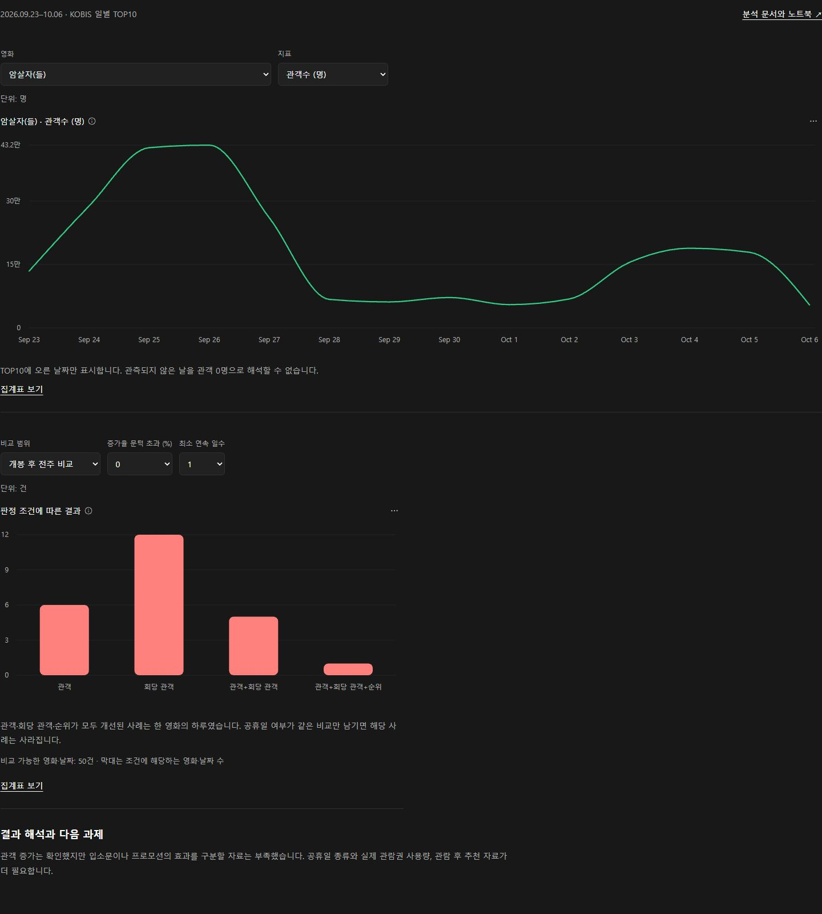
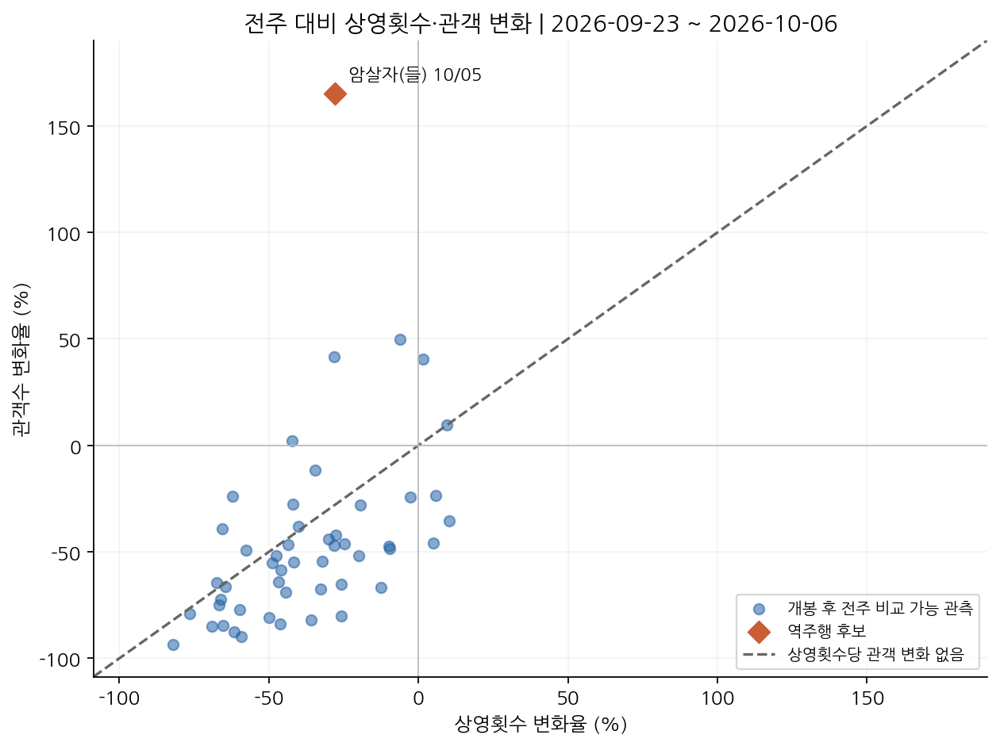

# 영화 관객 증가와 상영 규모 분석



*저장소에 포함된 대시보드 화면입니다. 상세 차트는 아래 HTML 파일을 내려받아 확인할 수 있습니다.*

[분석 결과 대시보드 열기](https://108chang.github.io/movie-boxoffice-rebound-analysis/dashboard.html) · [HTML 파일 다운로드](dashboard.html)

대시보드에서 집계 지표를 비교하고 차트의 원본 집계표를 확인할 수 있습니다. HTML 파일은 다운로드한 뒤 브라우저에서도 열 수 있습니다.

**코드잇 스프린트 미션 16** · [전체 포트폴리오](https://github.com/108chang/codeit-data-analysis) · [프로젝트 비교](PORTFOLIO.md)

[보고서 PDF](docs/미션16_최종보고서.pdf) · [분석 노트북](notebooks/미션16_영화_역주행_분석.ipynb) · [분석 결정 기록](docs/분석_결정_기록.md)

전주 대비 관객이 늘어난 영화의 상영횟수와 회당 관객 비교

영화 관객이 늘었다는 사실만으로 입소문이 났다고 말할 수 있을까? 관객수에는 상영 기회, 요일, 공휴일, 홍보 행사도 영향을 줄 수 있다. 이 프로젝트는 관객 증가를 먼저 확인하고, 그 증가를 어디까지 설명할 수 있는지 따져보는 데서 출발했다.

**핵심 결과:** 14일 자료에서 관객·회당 관객·순위가 전주보다 모두 개선된 사례는 한 영화의 하루였다. 그러나 비교일과 공휴일 조건이 달랐고, 연속 2일을 요구하면 같은 기준을 충족한 사례가 없었다. 이 자료만으로 입소문이나 관람권 지원의 효과를 구분할 수는 없다.

## 분석 목적

박스오피스 순위만 나열하면 어떤 영화가 많이 팔렸는지는 알 수 있다. 하지만 왜 관객이 늘었는지는 설명하기 어렵다. 과제에서 요구한 웹 스크래핑과 API 수집을 연결해, 흥행 규모와 관객 변화의 해석을 함께 다루고 싶었다.

처음에는 ‘입소문 영화 찾기’를 생각했다. 분석을 진행하면서 관객수와 순위가 입소문 자체를 측정하지는 않는다는 점을 확인했다. 그래서 질문을 ‘입소문이 났는가’에서 ‘어떤 반등이 관측됐고, 다른 설명은 무엇인가’로 좁혔다.

## 자료와 지표를 선택한 이유

| 선택 | 이유 | 남는 한계 |
|---|---|---|
| KOBIS 일별 TOP10 | 같은 영화의 관객·스크린·상영횟수·순위를 날짜별로 비교하기 위해 | TOP10 밖의 관객은 알 수 없다 |
| Cine21 상세정보 | 장르·등급·감독·국가·전문가 평가로 영화의 특성을 살펴보기 위해 | 작은 선택 표본이며 평가자 수도 영화마다 다르다 |
| 전주 같은 요일 비교 | 주말과 평일을 비교해 반등으로 오해하는 일을 줄이기 위해 | 같은 요일이라도 공휴일 조건은 다를 수 있다 |
| 상영횟수당 관객 | 상영이 많아서 관객이 늘어난 경우와 회당 관객이 늘어난 경우를 구분하기 위해 | 좌석 수가 없어 좌석점유율은 계산할 수 없다 |
| 관객·회당 관객·순위 별도 판정 | 상대순위 때문에 관객 증가가 가려지는 일을 막기 위해 | 1위를 유지한 영화는 순위가 더 오를 수 없다 |
| 기준별 비교 | 증가율과 지속 조건에 따라 결과가 달라지는지 확인하기 위해 | 첫 결과를 본 뒤 추가한 탐색 분석이며 사전 등록한 기준은 아니다 |

관객수는 `상영횟수 × 상영횟수당 관객`으로 나눠 볼 수 있다. 이 관계는 관객 변화의 구성을 설명한다. 상영횟수와 관객 수요 중 어느 쪽이 먼저 변했는지를 밝히지는 않는다.

## 주요 분석 결과

분석 기간은 **2026-09-23~2026-10-06**이다. KOBIS 140행에는 영화 17편이 포함돼 있다. 기간 내 영화의 Cine21 상세정보를 추가로 찾았고, 제목·개봉일이 확인된 16편을 연결했다. 감독·국가도 KOBIS 영화 상세정보와 대조했다. 확인하지 못한 값은 그대로 남겼다.

전주 비교가 가능한 관측은 52건이었다. 개봉 전 시사회와 개봉 후 흥행을 비교한 2건을 제외하면 50건이 남는다. 그중 관객이 늘어난 관측은 6건, 회당 관객이 늘어난 관측은 12건이었다. 여기서 ‘건’은 영화 한 편의 하루이며, 서로 다른 영화 수가 아니다.

관객·회당 관객·순위가 모두 개선된 사례는 10월 5일 **암살자(들)** 한 건이었다. 관객은 전주 대비 약 165.3% 늘었고 순위는 2위에서 1위로 올랐다. 상영횟수는 약 28.1% 줄었지만 회당 관객은 약 268.8% 늘었다. 상영횟수 증가만으로 설명되는 반등은 아니었다.

그러나 해당일은 대체공휴일이고 비교일은 일반 월요일이었다. 공휴일 여부가 같은 비교만 남기면 28건이며, 기존의 세 지표를 모두 충족한 사례는 남지 않는다. 이 28건에도 추석 연휴와 개천절을 비교한 7건이 포함된다. 따라서 이를 ‘공휴일 효과를 제거한 결과’라고 부르지 않았다.

0·10·20% 초과와 연속 1·2일, 지표 조합, 공휴일 비교 조건을 바꾼 48개 설정을 모두 기록했다. 세 지표를 모두 충족하는 기준에서는 증가율 문턱을 바꿔도 같은 하루만 남았다. 연속 2일을 요구하면 후보가 없었다. 관측 기간이 짧고 비교 가능한 날짜가 제한돼 있으므로, 이 결과가 지속적 반등의 부재를 증명하지는 않는다.

## 관객 증가를 입소문으로 단정할 수 없는 이유



가로축은 전주 대비 상영횟수 변화율, 세로축은 관객 변화율이다. 점 하나는 영화 한 편의 하루다. 대각선 위의 관측은 회당 관객이 개선된 경우이며, 입소문이 확인된 경우를 뜻하지는 않는다.

관객 증가를 입소문으로 부르려면 관람 후 추천, 만족도, 자발적인 리뷰 같은 자료가 필요하다. 이번 자료에는 그 정보가 없다. 관람권 지원과 단체관람, 관람 독려, 평점 관련 논란도 별도 자료로 검토했지만, 실제 티켓 사용량과 전국 규모를 확인하지 못했다.

사건일과 기사일, 제공량과 실제 사용량, 시행과 취소를 구분한 이유가 여기에 있다. 제공된 관람권 수를 전국 관객수에서 빼거나, 취소된 행사의 계획 인원을 실제 관객으로 더하지 않았다. 다른 영화의 프로모션 자료도 같은 깊이로 확보되지 않았으므로 특정 영화만의 효과를 비교하지 않았다.

**관객 증가는 확인했지만, 그 원인을 입소문으로 판단할 자료는 부족했다.** 입소문이 없었다는 뜻은 아니다. 관련 외부 자료의 사실관계와 출처는 별도 참고 문서에 정리했다.

## 실행 방법과 검증 범위

과제 제출본은 수집 자료를 노트북에 포함하고 기간을 고정했다. 실행 날짜가 달라져도 저장된 자료로 같은 계산을 반복할 수 있다. API 키가 필요한 새 수집은 별도 모드로 구분한다. 기존 Colab 보안 비밀 `KOBIS_API_KEY`를 사용하며 키 값은 파일에 넣지 않는다.

저장 자료에 대한 재검토에서는 정확한 전일·전주 비교 170쌍의 주요 변화율, 48개 판정 조건, 파일 해시 32개를 독립적으로 확인했다. 이 검증은 저장 자료와 계산이 일치하는지에 대한 검사다. 원래 API 응답과 기사 내용을 모두 독립 재조회한 검증은 아니다.

원래 일별 수집 당시 JSON·HTML은 보존되지 않았다. 같은 결과를 재현할 수 있다는 사실과 원자료의 진위를 독립적으로 확인했다는 주장을 구분했다. 새 수집부터 원응답을 보존하도록 보완했으며, 최신 수집 모드 전체 실행은 이번 재검토 범위에 포함하지 않았다.

## 후속 분석 과제

1. 더 긴 기간과 TOP10 밖 관객을 확보해 반등이 이어지는지 확인한다.
2. 공휴일 유형과 개봉 후 경과일이 비슷한 비교를 만든다.
3. 실제 좌석 수를 확보해 회당 관객과 좌석점유율을 구분한다.
4. 관람 인증 리뷰·추천 여부·프로모션 실제 사용 기록으로 입소문과 다른 유입 경로를 구분한다.

기간만 늘려도 모든 문제가 해결되는 것은 아니다. 더 긴 TOP10 자료 역시 순위 밖 관객과 관람 동기를 알려주지는 않는다.

## 저장소 구성

```text
README.md
notebooks/       # 제출본과 설명을 다듬은 노트북
docs/           # 분석 결정 기록, 재검토 결과, 출처
figures/        # README에서 설명할 핵심 그림
data/           # 공개 범위를 확인한 자료와 데이터 사전
```

README에는 관객·순위 시계열, 상영횟수와 관객 변화, 개봉 이후 TOP10에 오른 일수처럼 질문에 직접 답하는 그림부터 둔다. 나머지 표와 그림은 노트북으로 연결한다. 전문가 20자평 원문은 공개본에서 제외했다. 점수와 평가자 수는 유지했다. 출처가 있는 제3자 자료에 이 저장소의 별도 이용 허락을 부여하지 않는다.

사용 도구: Python, pandas, requests, BeautifulSoup, Matplotlib, Google Colab. 코딩·자료 정리에는 AI 도구의 도움을 받았으며, 사용한 기준과 확인 범위는 문서에 남겼다.

상세 자료:

- [설명을 다듬은 노트북](notebooks/미션16_영화_역주행_분석.ipynb)
- [분석 결정 기록](docs/분석_결정_기록.md)
- [2026-10-11 재검토](docs/재검토_2026-10-11.md)
- [문장 수정 기록](docs/문장_수정기록.md)
- [관객·순위 시계열](figures/03_audience_rank_timeseries.png)
- [개봉 후 TOP10 등장일수](figures/08_post_open_persistence.png)

## 실행과 결과 확인

1. Python 3.12 환경에서 `pip install -r requirements.txt`로 필요한 패키지를 설치한다.
2. `notebooks/미션16_영화_역주행_분석.ipynb`를 Jupyter 또는 Colab에서 열고 위에서부터 모두 실행한다. 기본 `submission_snapshot` 모드는 키 없이 같은 자료로 계산한다.
3. 저장 CSV의 계산 검증은 저장소 최상위에서 `python scripts/validate_analysis.py`를 실행한다. 170개 전일·전주 비교쌍, 후보 설정 48개, 배포 데이터 해시를 확인한다.

새 수집은 Colab에서 `DATA_MODE`를 `live_fixed` 또는 `live_latest`로 바꾸고 보안 비밀 `KOBIS_API_KEY` 접근을 허용한다. 최신 수집의 공휴일과 외부 사건은 해당 기간에 맞게 다시 확인해야 한다.

- [최종 보고서](docs/미션16_최종보고서.md)
- [제출용 PDF](docs/미션16_최종보고서.pdf)
- [데이터 사전](data/data_dictionary.csv)
- [비교 가능한 관측의 흐름](data/comparison_flow.csv)
- [판정 기준별 결과](data/candidate_sensitivity.csv)
- [외부 자료와 출처](docs/외부자료_참고.md)

2026-10-11 최종본에서는 제출본과 공개본을 각각 처음부터 재실행했다. 새 수집 모드와 외부 자료의 최신 정정 여부까지 검증한 것은 아니다. 전문가 평론 원문 제외는 공개 파일의 편집 조치이며, 관객·순위·상영 분석 결과에는 영향을 주지 않는다.

[최종 실행·PDF 검증 기록](docs/최종_검증_기록.md)


