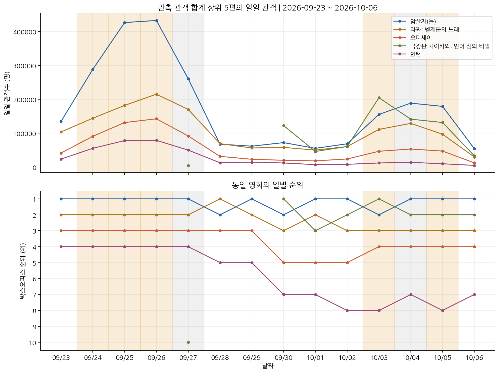

# 관객이 늘었다고 입소문일까?

## 상영 규모와 관객 변화로 살펴본 영화의 역주행 패턴

스프린트 미션 16 | 분석 기간 2026-09-23~2026-10-06 | 최종 정리 2026-10-11

## 핵심 결과

관객·상영횟수당 관객·순위가 전주보다 모두 개선된 사례는 암살자(들)의 10월 5일 관측 한 건이었다. 관객은 165.3% 늘었지만, 해당일은 대체공휴일이고 비교일은 일반 월요일이었다. 공휴일 여부가 같은 비교만 남기면 엄격한 후보는 없었다.

이 결과는 입소문이 없었다는 증거가 아니다. 관객 반등은 확인했지만, 입소문과 공휴일·프로모션 등 다른 원인의 영향을 구분할 자료가 부족했다. 무료 관람권 배포가 반등을 만들었다는 결론도 내릴 수 없다.

## 왜 이 분석을 했나

박스오피스 순위는 어떤 영화가 많이 팔렸는지 보여준다. 그러나 관객이 왜 늘었는지는 알려주지 않는다. 처음에는 입소문 영화를 찾으려 했지만, 관객수와 순위만으로 관람 동기를 측정할 수 없다는 점을 확인했다. 그래서 질문을 관측 가능한 반등과 그 해석의 한계로 좁혔다.

| 분석 질문 | 확인한 내용 |
|---|---|
| 1. 전주보다 관객이 늘었나? | 개봉 후 비교 50건 중 관객 증가 6건 |
| 2. 상영 기회도 함께 늘었나? | 회당 관객 개선 12건; 세 지표 동시 개선 1건 |
| 3. 반등과 TOP10 등장이 이어졌나? | 엄격한 후보 연속 2일 없음; 5편은 14일 모두 등장 |

건은 영화 한 편의 하루를 뜻한다. 동일 영화의 여러 날짜는 서로 독립된 표본이 아니다. 이 보고서는 유의성 검정이나 흥행 원인의 인과 추정을 수행하지 않은 탐색 분석이다.

# 1. 비교할 수 있는 자료부터 구분했다

KOBIS 일별 TOP10 14일을 모아 영화-일 140행, 영화 17편을 확보했다. Cine21의 현재 박스오피스와 상세 페이지를 수집하고 기간 내 영화 정보를 보완했다. 16편의 정보를 연결했으며 140행 중 139행이 매칭됐다. 미매칭 영화와 결측값은 분석 표에 남겼다.

| 자료 | 구조와 쓰임 |
|---|---|
| KOBIS | 날짜와 movieCd를 기본 키로 관객·순위·스크린·상영횟수 비교 |
| Cine21 | 영화 16편, 전문가 20자평 71개; 장르·등급·시간·국가·감독·별점 보완 |
| 결합 확인 | 정리한 영화명과 개봉일 확인; 감독·국가를 KOBIS 상세정보와 대조 |
| 외부 사건 | 사건일과 기사일, 시행·취소, 제공량과 사용량을 분리 |

## 왜 전주 같은 요일과 비교했나

평일과 주말을 바로 비교하면 요일 효과를 반등으로 오해할 수 있다. 정확히 7일 전 같은 영화가 관측된 경우만 전주 변화율을 계산했다. TOP10에서 빠진 날짜는 관객 0명으로 바꾸거나 앞뒤 날짜로 대신하지 않았다. 개봉 후 경과일이 7일 미만인 비교도 기본 후보에서 제외했다.

| 단계 | 영화-일 관측 수 |
|---|---|
| 전체 TOP10 | 140 |
| 정확한 전주 비교 가능 | 52 |
| 개봉 후 7일 이상 | 50 |
| 공휴일 여부 동일 | 28 |

공휴일 여부가 같은 28건에도 추석 연휴와 개천절을 비교한 7건이 들어 있다. 따라서 공휴일 효과를 제거했다고 표현하지 않았다. 날짜와 개봉 시점이 비슷한 비교가 필요하다.

## 지표의 뜻

관객 증감률 = (당일 관객 / 비교일 관객 - 1) × 100. 회당 관객 = 일일 관객 / 상영횟수. 순위 개선 = 비교일 순위 - 당일 순위. 스크린·상영횟수 변화율도 같은 방식으로 계산했다. 좌석 수가 없어 회당 관객은 좌석점유율을 뜻하지 않는다.

# 2. 반등은 있었지만 원인은 확인하지 못했다

그림 1. 관객과 순위의 일별 변화. 순위 1위가 위에 오도록 표시했다. TOP10에서 관측되지 않은 날은 관객 0명으로 채우지 않았다. 시계열의 등락만으로 관람 동기를 판단할 수는 없다.

| 10월 5일 암살자(들) | 전주 같은 요일 대비 |
|---|---|
| 일일 관객 | 67,404명 → 178,856명; +165.3% |
| 순위 | 2위 → 1위 |
| 상영횟수 / 스크린 | -28.1% / -14.2% |
| 상영횟수당 관객 | +268.8% |

관객이 늘 때 상영횟수는 줄었다. 따라서 이 하루의 반등을 상영횟수 증가만으로 설명할 수는 없다. 하지만 10월 5일 대체공휴일과 9월 28일 일반 월요일이라는 차이가 남는다. 공휴일 여부가 다른 비교를 제외하면 이 사례도 제외된다.

기본 조건 50건에서 관객 증가 6건, 회당 관객 개선 12건, 순위 개선 1건을 따로 기록했다. 순위는 상대 지표이므로 관객이 늘어도 다른 영화가 더 크게 늘면 오르지 않는다. 1위 유지 영화도 더 높은 순위로 갈 수 없다. 세 지표의 동시 개선은 보수적인 탐색 기준이며 입소문의 판정 기준이 아니다.

# 3. 상영 변화와 지속 조건을 함께 살폈다

그림 2. 전주 대비 상영횟수 변화율과 관객 변화율. 점 하나는 영화 한 편의 하루다. 대각선 위의 점은 회당 관객이 개선된 관측이다. 관객수 = 상영횟수 × 회당 관객이라는 관계는 변화의 구성을 보여주며, 어느 변화가 먼저 일어났는지는 알려주지 않는다.

## 왜 기준을 여러 가지로 비교했나

첫 결과를 확인한 뒤 증가율 기준 0·10·20% 초과, 지표 조합 4개, 연속 1·2일, 공휴일 비교 조건 2개를 조합한 48개 설정을 추가로 검토했다. 사전 등록한 분석은 아니다. 특정 결과에 유리한 기준 하나만 제시하지 않고 비교한 설정을 모두 기록했다.

엄격한 세 지표 결합 기준에서는 증가율 문턱을 바꿔도 같은 하루만 남았다. 연속 2일을 요구하면 후보가 없었다. 짧은 관측 기간과 제한된 비교 날짜 때문에 지속적 반등이 없었다고 일반화할 수는 없다.

## TOP10 등장일수는 흥행 수명과 다르다

오디세이, 암살자(들), 타짜: 벨제붑의 노래, 인턴, 옵세션은 14일 모두 TOP10에 있었다. 개봉 후 등장 비율의 분모는 관측 기간 안에서 개봉 후 지난 달력 일수로 정했다. 개봉 전 시사회는 따로 셌다. 신작이 7일 중 7일 등장해 100%를 기록해도 14일 관측한 영화와 같은 지속성을 입증하지 않는다.

# 4. 외부 사건은 원인 판단의 한계를 보여준다

암살자(들) 관련 자료는 2026-10-07까지 확인한 기사와 주최 측 공개 설명을 토대로 정리했다. 역사 왜곡 논란의 진위를 이 분석에서 판정하지 않았으며, 특정 진영의 목적이나 전국적 조직 배포를 확인된 사실로 제시하지 않았다.

| 구분 | 확인 범위 / 분석에서의 처리 |
|---|---|
| 9월 28일 관람권 제공 보도 | 122매 제공; 실제 사용량 미확인. 전국 관객에서 차감하지 않음 [1] |
| 회사 설명 | 퇴직연금 고객 행사라는 설명과 다른 영화 행사 언급; 발언 주체를 표시 [2] |
| 계획 변경·취소 행사 | 10월 14일 예정 행사 변경 및 무료 시사회 취소 보도. 계획 인원을 실제 관객으로 합산하지 않음 [3,4] |
| 온라인 평점 관련 의혹 | 의심 사례 및 조사 의뢰 보도 수준. 조작 확정이나 사법 판단으로 쓰지 않음 [5] |

제공된 표는 사용된 표와 다르다. 9월 28일의 일부 지역 행사와 10월 5일 전국 관객 증가는 날짜·범위가 달라 직접 연결할 수 없다. 다른 영화의 프로모션도 같은 깊이로 조사되지 않았다. 사건표의 빈칸을 프로모션 없음으로 해석하면 비교가 한쪽으로 치우친다.

## 전문가 평가도 보조 정보로만 사용했다

전문가 별점이 있는 영화는 13편이고 평가자 수는 영화별로 1~11명이다. 작은 TOP10 선택 표본이며 평가의 정밀도도 다르다. 별점과 흥행의 일반적 관계나 장르 효과를 입증했다고 주장하지 않았다. 온라인 이용자 평점은 만족도의 대리변수로 사용하지 않았다.

## 다음 분석에 필요한 자료

28~56일 이상과 TOP10 밖의 일별 관객, 공휴일 유형과 개봉 경과일, 실제 좌석 수가 필요하다. 입소문을 설명하려면 관람 인증 리뷰·추천 여부 등 관람 후 행동 자료가 있어야 한다. 프로모션 효과를 비교하려면 실제 관람권 사용일·수량과 다른 영화의 동일 기준 조사 자료가 필요하다.

# 5. 검증 범위와 출처

2026-10-11에 제출용과 공개용 노트북을 각각 위에서부터 실행해 오류 없이 마쳤다. 저장 CSV에서 정확한 전일·전주 비교 170쌍의 주요 변화율과 순위를 재계산했고, 후보 설정 48개를 확인했다. 공개본은 전문가 20자평 원문을 제외하고 점수·평가자 수를 유지한다. 관객 분석 결과는 제출본과 같다.

원래 일별 수집 당시 API JSON과 HTML은 보존되지 않았다. 같은 CSV로 계산을 재현하는 것과 원자료 진위를 소급해 독립 검증하는 것은 다르다. 새 수집부터 원응답을 저장하도록 보완했다. 최신 수집 모드 전체 실행과 외부 기사 최신 정정 여부의 재확인은 이번 검증에 포함하지 않았다.

## 실행과 파일 안내

제출 노트북의 기본 모드는 submission_snapshot이다. 키 없이 고정 자료를 다시 계산한다. 새 수집을 할 때만 Colab의 보안 비밀 KOBIS_API_KEY를 읽는다. 키 값은 제출·공개 파일에 포함하지 않는다. CSV는 UTF-8 BOM으로 저장했다. 데이터 사전과 결합 감사표, 민감도 표에서 계산 구조를 확인할 수 있다.

공개 저장소: https://github.com/108chang/movie-boxoffice-rebound-analysis

## 주요 출처

- [KOBIS Open API](https://www.kobis.or.kr/kobisopenapi/homepg/main/main.do)
- [Cine21 영화 정보](https://www.cine21.com/)
- [[1] 비즈트리뷴, 관람권 제공 보도 (2026-10-02)](https://www.biztribune.co.kr/news/articleView.html?idxno=359982)
- [[2] YTN, 회사 설명과 다른 영화 행사 언급 (2026-10-01)](https://www.ytn.co.kr/_ln/0103_202610012311592780)
- [[3] 채널A, 계획 행사 변경 보도 (2026-09-30)](https://v.daum.net/v/20260930193154199)
- [[4] 파이낸셜뉴스, 무료 시사회 취소 보도 (2026-10-02)](https://www.fnnews.com/news/202610021649434222)
- [[5] 이데일리, 관람평 관련 의혹 보도 (2026-10-04)](https://www4.edaily.co.kr/News/Read?mediaCodeNo=257&newsId=01643286645609640)
전체 외부 사건의 출처·기사일·시행 여부는 external_events.csv와 외부자료 참고 문서에 기록했다. 코드 작성과 자료 정리에 AI 도구를 활용했으며, 판단 기준과 확인 범위를 문서로 남겼다.
